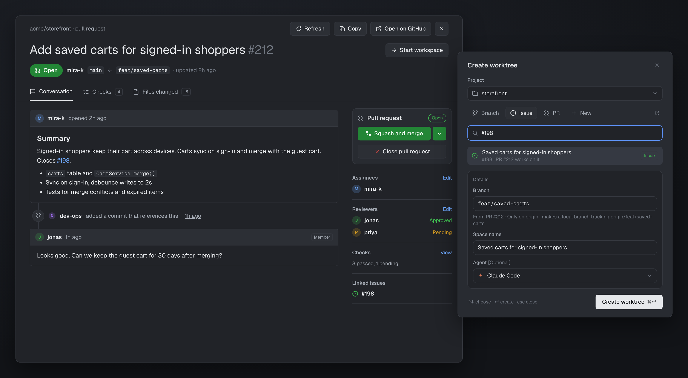

# Issues & worktrees

GitHub issues and pull requests inside Herdr, after the Orca app: a table of the repo's issues and
PRs, an in-app viewer for either (PRs get Checks and Files changed tabs and a merge card), and a
**Create worktree** dialog that starts work from a branch (including ones only on the remote), an
issue, a PR or a new name, with Claude's prompt prefilled. Two mods: `issues` and `new-worktree`.

## What you see

- **Issues table** (`mod.open issues`, a frameless dialog, 92% × 90%): a close button, the repo
  (`GitHub · This Mac · owner/repo`), **Issues** / **PRs** chips, a repository picker, a search box
  (GitHub search syntax), **Filters**, then rows of number, title, labels, assignee avatars, a
  status pill (Open green, closed purple/grey), "updated N ago" and **Start** / **Open**, 25 a page.
- **Viewer** (86% × 90%): Back, the repo, Refresh, Copy (link, reference, number and title),
  Open on GitHub, close. A 30px title with `#N`, a state pill (Open, Draft, Merged, Closed),
  and for a PR its author and `base ← head` branches. Comments as GitHub cards with avatars,
  markdown, images and reactions; timeline events (labels, assignments, mentions, commits).
  A right sidebar: Assignees, Labels, Milestone, Development / Linked issues, Participants.
  PRs add **Conversation · Checks · Files changed (N)** tabs, a **Pull request** card (Squash and
  merge with a ▾ for merge commit or rebase, then a confirm button; Close / Reopen; Ready for review
  on drafts; a note when blocked, behind or conflicting), Reviewers and a Checks summary.
- **Create worktree** (560 × 780 dialog): Project (the repos open as spaces), tabs
  **Branch · Issue · PR · New**, a search box and its matches (existing checkouts tagged **Open**,
  **Local** branches, **Remote**-only branches), ↻ to fetch origin, a **Create from** base pill
  (only when making a new branch from the base), and a **Details** box: **Branch**, **Space name**
  and **Agent**, with a line under Branch saying what Create will do. **Create worktree ⌘↵**.

## How it behaves

- Status pills and row menus (assignee, status, ⋯ copy/open) open under the control pressed.
  Filters edit the search query; the table refreshes every minute and after any change.
- **Start** on a row opens Create worktree with that issue or PR picked; **Open** switches to the
  space already on its branch.
- In the viewer, `#123`, `owner/repo#123` and GitHub links open in place, with Back. Commenting,
  closing (as completed / not planned), reopening, labels, assignees and reviewers go through
  `gh`; quick successive toggles queue. Merge always asks to confirm. A file in Files changed
  expands to its diff (first 400 lines, colored +/−).
- Create worktree: picking fills Branch and Space name; both stay editable.
  - Branch tab: a checkout opens its space; a local branch is checked out; a remote-only branch
    becomes a local branch tracking `origin/<name>`; renaming a picked branch makes a new branch
    from it.
  - Issue tab: the branch comes from the `issue_branch` template (`dev/feat/{number}`, with
    `{slug}` available) or from the open PR that closes the issue; an existing branch is reused.
  - PR tab: the PR's head branch, fetched when needed.
  - New tab: a new branch from the base, not tracking it.
  - `#123` or a link in Branch/New jumps to its tab. A typed space name names the space.
  - Issue and PR picks write `branch.<b>.herdr-issue` / `herdr-pr` (`owner/repo#N`) to git config.
  - With Claude as the agent, the issue/PR task is pasted into Claude's prompt once it's ready
    (past the folder-trust prompt), not sent; the clipboard is restored. Remote: clipboard + toast.
  - A dialog creates or opens at most once (⌘↵ held or pressed twice makes one space).
- Agent status isn't shown here; these are GitHub and git views.

## Built from

- `mods/issues/`: `main.js` (table and its popups; `props.issue` makes a viewer, `props.menu` a
  menu, `props.copyMenu` the copy menu), `viewer.js`, `pr.js` (checks, files, diffs, linked
  issues), `start.js` (Start → `new-worktree`), `icons.js` (Lucide SVGs written to
  `data/issues/icons`, avatars via `curl` to `data/issues/avatars`), `pictures.js` (comment images),
  `prefill.sh` (the Claude prompt prefill helper). `mod.json` overlay: frameless dialog 0.92 × 0.9.
- `mods/new-worktree/`: `main.js` (the dialog), `git.js` (branches, worktrees, PRs, issues),
  icons, `mod.json` with `settings.issue_branch`.
- Herdr API: `exec`, `openOverlay`/`closeOverlay`, `shared`/`setShared` (`issues.pick`,
  `issues.changed`), `spaces`, `panes`, `focused`, `knownAgents`, `run` (`space.new`,
  `space.select`, `space.rename`), `readTextFile`, `notify`.
- Programs: `gh` (logged in), `git`, `curl`, `sh`, and on macOS `pbcopy`/`pbpaste`, `hc`, `jq`
  and `herdr-app` for the prefill helper.

## Watch out

- Popups default to "the pointer", which Herdr doesn't track over dialogs; anchor them from the
  pressed control's `bounds`.
- GitHub only links "Closes #N" when the PR targets the default branch, so issue → PR matching also
  reads PR bodies and branch names.
- `gh issue view` answers for PR numbers too; use `repos/<r>/issues/<n>` `.pull_request` to tell.
- Claude prints a non-breaking space after `❯`. A fresh Claude reports no status until its first
  turn, so the prefill helper watches the screen, not the status.
- `cx.spawn` runs synchronously until its first `await`.
- Worktrees go to `~/.herdr/worktrees/<repo>/<branch with / as ->`, as Herdr's own worktree mod.
- The table's repo comes from the focused terminal's folder (then the last one used).

## Done when

- `herdr-app check` passes for both mods.
- The table lists a repo's issues and PRs; filters and paging work; Start opens Create worktree
  with the row picked.
- A PR in the viewer shows its tabs, checks, files (a file expands to its diff) and merge card.
- In Create worktree, a remote-only branch makes a tracking worktree and a space; an issue fills
  `dev/feat/N` and its title; a branch already checked out says "opens it"; ⌘↵ twice makes one space.
