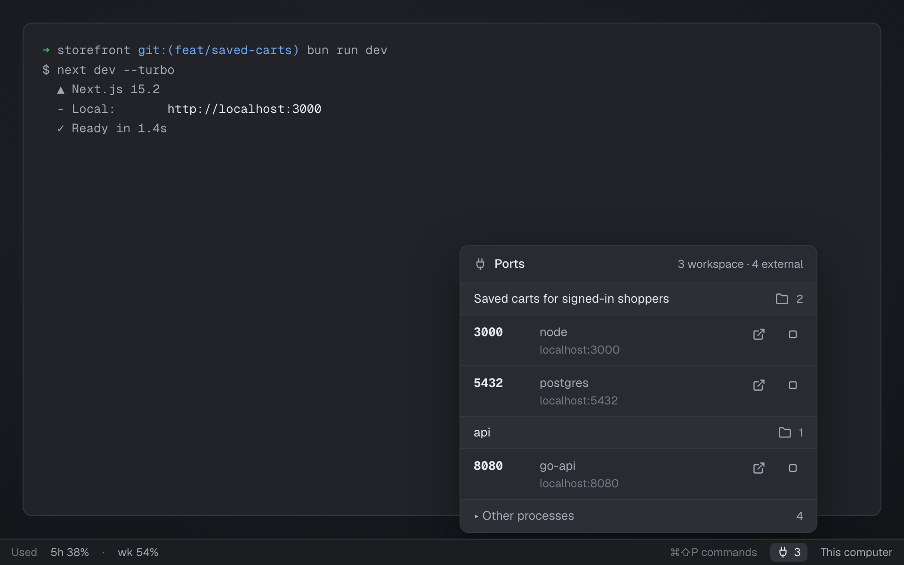

# Live ports

The TCP ports listening on this computer, grouped by the Herdr space whose git checkout started
them: a small plug-and-count button for a status bar, and a popup above it listing each port with
Open and Stop. Other mods (such as a sidebar) can read the same list from shared state.

## What you see

- **Button**: right-aligned in its block on `chrome` with a 1px top `border`: a plug icon and the
  number of ports in your spaces (11.8px, `foreground`, `muted` at zero), a 20px rounded hover
  target. Tooltip: "N workspace · M external ports".
- **Popup** (380px wide, as tall as its rows up to 440px of list, opened so its bottom edge sits 6px
  above the button, right edges aligned): a 40px header with the plug, **Ports** and
  "N workspace · M external"; then one 34px group per space (`raised`, the space name, a folder
  icon, its count) and a 54px row per port: the port in the code font, bold; the process name and
  `localhost:<port>`; **Open in browser** and **Stop** icon buttons. Ports from processes outside
  your spaces sit under a folded **▸ Other processes** group.
- Empty: "No ports listening in your worktrees."

## How it behaves

- Scans every 4 seconds while the window is active, and publishes only real changes to shared
  `live-ports` as `{ bySpace: { <space id>: [{ port, pid, name, address }] }, external: [...] }`.
- A port belongs to the space whose checkout holds the listening process's working folder (the
  deepest checkout wins). Only local spaces are scanned.
- Clicking a group switches to that space. Open launches `http://localhost:<port>`; Stop sends the
  process `kill` and drops it at once (the next scan confirms).
- `live-ports.open` (a key in `keys.json`) opens the popup over the button.
- Agent status isn't shown.

## Built from

- `mods/live-ports/`: `main.js` (button; `props.view: "popup"` or an overlay draws the list),
  `scan.js` (pure parsing and matching), `plug.svg`, `folder.svg`, `external.svg`, `stop.svg`.
  `mod.json`: `{ "place": "none", "title": "Live Ports", "overlay": { "kind": "popup", "width": 400, "height": 480 } }`.
- Put it in a layout block, e.g. a status bar row:
  `{ "id": "live-ports", "type": "block", "size": { "px": 64 }, "content": { "mod": "live-ports" } }`.
- Herdr API: `exec`, `spaces`, `panes`, `shared`/`setShared`, `openOverlay`/`closeOverlay`,
  `run("space.select")`, `nextCommand`, `settings().zoom`.
- Programs: `lsof` (listeners and their working folders), `git rev-parse --show-toplevel`, `kill`.

## Watch out

- `lsof -nP -iTCP -sTCP:LISTEN -F pcn` lists listeners; a second `lsof -a -d cwd -F n -p <pids>`
  gives their folders. Folders and repo roots are cached per process and folder.
- The popup's size is computed from fixed row heights so it can be placed exactly; the button's
  position comes from its own `bounds`, scaled by zoom.
- `setShared` redraws every mod: publish only when the JSON changes.
- macOS and Linux (needs `lsof`); remote machines aren't scanned.

## Done when

- `herdr-app check mods/live-ports` passes.
- Starting a dev server in a worktree space raises the count within a few seconds; the popup lists
  it under that space with its process name.
- Open launches the browser on that port; Stop ends the process and it disappears.
