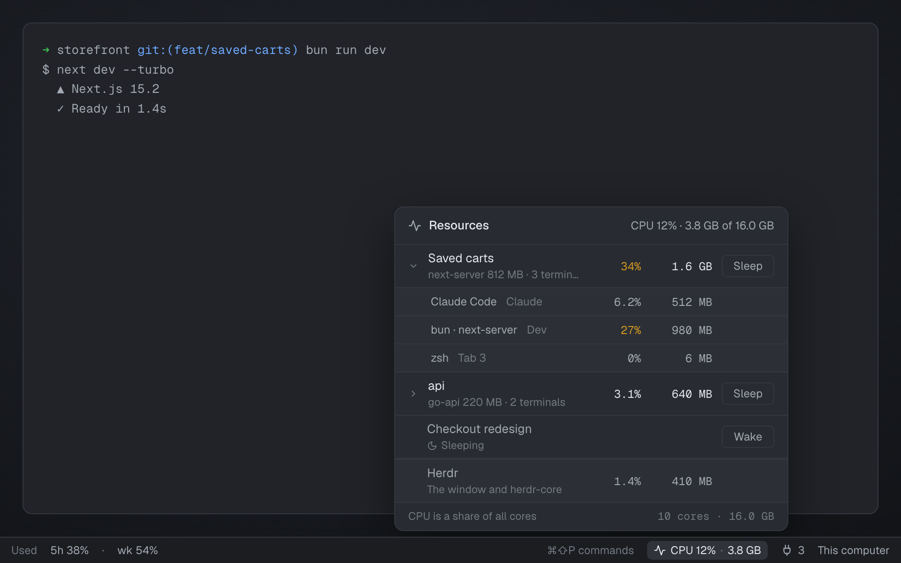

# Resources

How much CPU and memory everything running in Herdr uses: a small meter for a status bar, and a
popup above it with a breakdown per space, its terminals, and Herdr itself. With
[Hibernate](../hibernate/) installed, each space gets Sleep and Wake.

## What you see

- **Button**: right-aligned in its block on `chrome` with a 1px top `border`: an activity icon,
  `CPU 12%`, a dim `·` and `3.8 GB` (11.8px, `muted`), a 20px rounded hover target. CPU turns yellow
  (`ansi3`) at 30% and red (`ansi1`) at 60%; memory at 30% and 50% of the machine's RAM; the icon
  takes the higher of the two. Tooltip: "Herdr on this computer: CPU 12% of 10 cores · 3.8 GB of
  16 GB RAM".
- **Popup** (420px wide, opened so its bottom edge sits 6px above the button, right edges aligned):
  a 40px header (icon, **Resources**, the totals), then one 46px row per space, heaviest memory
  first: a ▸/▾ chevron, the space name and under it its heaviest process and terminal count, CPU and
  memory in the code font, and a **Sleep** button. Expanded, a 30px row per terminal: the program
  (and its heaviest child, e.g. `Claude Code · next-server`), its tab, CPU and memory. A pinned
  **Herdr** row (the window and herdr-core) and a footer ("CPU is a share of all cores", or
  "This computer only" when there are remote spaces; the core count and RAM).
- A sleeping space shows a moon, "Sleeping" and **Wake**, even with nothing running.

## How it behaves

- Every 5s (every 30s while the window isn't in front) one `ps -axo pid=,ppid=,pcpu=,rss=,comm=`
  is read. Each live local terminal's process tree is summed from its shell pid and grouped by its
  `herdr.space` label (a sub-agent counts in its parent's space). Herdr's own app and core trees,
  minus the terminals, are the Herdr row and count in the total.
- Terminal pids come from `hc get --json` only for a new terminal or one whose shell pid vanished,
  and are cached.
- CPU is the `ps` sum divided by `hw.ncpu`, so 100% means every core is busy.
- The button redraws only when its text or colour changes, and it never writes shared state.
- Click a space to expand it; click a terminal to go to its pane (`pane.focus`).
- **Sleep** / **Wake** set shared `hibernate.request` to `{ nonce, action, space }`; the
  hibernate mod does the work and publishes `hibernate.sleeping`. Without it, the buttons do nothing.

## Built from

- `mods/resources/`: `main.js` (the button; `props.view: "popup"` or an overlay draws the popup),
  `measure.js` (parsing `ps`, the trees, grouping by space), `activity.svg`, `moon.svg`.
- `mod.json`: `{ "place": "none", "title": "Resources", "overlay": { "kind": "popup", "width": 420, "height": 400 } }`.
- Put it in a status bar row:
  `{ "id": "resources", "type": "block", "size": { "px": 150 }, "content": { "mod": "resources" } }`.
- Herdr API: `exec`, `hc`, `terminals`, `spaces`, `settings`, `window`, `shared`/`setShared`,
  `openOverlay`/`closeOverlay`, `run("pane.focus")`.
- Programs: `ps`, `sysctl -n hw.memsize hw.ncpu`.

## Watch out

- `comm` is the last `ps` column and may hold spaces: parse the first four numbers, then the rest.
- Sum each tree once (a terminal inside Herdr's own tree is claimed first), or memory double-counts.
- The popup's height comes from fixed row heights so it can be placed exactly above the button.
- macOS (`sysctl hw.memsize`); remote machines aren't measured.

## Done when

- `herdr-app check mods/resources` passes.
- The status bar shows `CPU n% · n GB`; starting a dev server in a space raises it within ~5s.
- The popup lists that space first with the server as its heaviest process; expanding shows its
  terminals; clicking one goes to its pane.
- With Hibernate installed, Sleep marks the space Sleeping and Wake brings it back.
